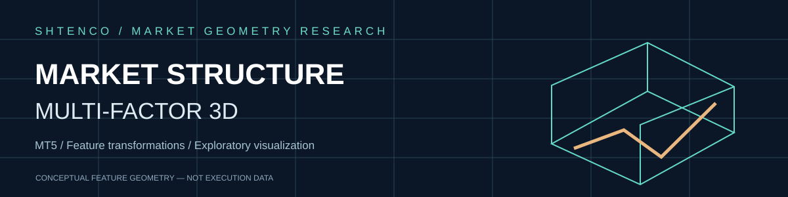
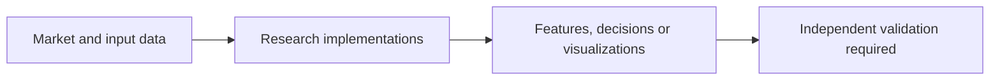
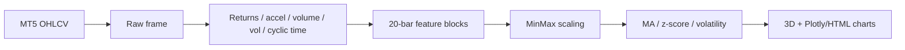

<div align="center">



**MT5 bar-to-feature transformation with 3D visualization**

[Overview](#engineering-overview) · [Architecture](#architecture-and-data-flow) · [Evidence](#validation-boundaries) · [Original technical dossier](#original-technical-dossier)

</div>

## Engineering overview

MT5 bar-to-feature transformation with 3D visualization. Primary code entry points: `3D_bars_market_structure.py`. This GitHub repository contains research assets and must not be interpreted as independently audited financial performance or production service.

## Architecture and data flow



The graph illustrates research responsibilities, not validated real-time connectivity.

## Validation boundaries

> The feature transformation is not conventional Renko; a per-value time scaler undermines temporal comparability.

The presence of source code proves implementation artifacts, **not** reproducible predictive superiority, live trading or investor returns. Validate dataset timing, splits, costs, model versions and results separately.

## Original technical dossier

---

#  3D Bars Market Structure — verified legacy research dossier

> **Статус:**  LEGACY /  R&D visualization-feature prototype.
> **Проверено по фактическому Python source:** 29.09.2026.
> **Важно:** название “3D Renko” историческое; current core строит transformed stationary-like features и visualizations, а не классический price-brick Renko engine.

## 1.  Задача

Repository исследует преобразование MT5 OHLCV/tick-volume data в многомерные market features и 3D/interactive visualization.

Main function:

`create_true_3d_renko(...)`

по факту создаёт feature blocks на rolling 20-bar window.

## 2.  Фактический состав

```text
3D_bars_market_structure/
├── 3D_bars_market_structure.py
├── README.md
└── .github/
```

Основная логика находится в одном Python script (~20 KB).

Dependencies imported directly in source include:

- MetaTrader5;
- pandas/numpy;
- sklearn MinMaxScaler;
- scipy.stats;
- matplotlib/seaborn/mplfinance;
- Plotly.

## 3.  Market data input

Source calls:

```python
mt5.copy_rates_range(symbol,timeframe,start_date,end_date)
```

and reads symbol spread/point via `mt5.symbol_info`.

The function drops missing rows and requires valid positive derived brick size:

[
minPriceBrick=
spread	imes multiplier	imes point
]

Но далее этот `min_price_brick` returned as metadata and is not used to construct classical Renko price bricks.

## 4.  Feature construction

For each rolling window, source derives:

### Time
[
sin(2pi hour/24),quad cos(2pi hour/24)
]

### Price
- typical price;
- percentage return;
- return acceleration.

### Volume
- tick-volume change;
- volume acceleration.

### Volatility
- rolling 20 return std;
- volatility percentage change.

Each block maps transformed values into fields named `open/high/low/close/tick_volume`.

Therefore those OHLC-like field names **do not represent original OHLC prices** after transformation.

## 5.  Important scaling issue

Inside the per-row loop:

```python
time_numeric = scaler.fit_transform([[single_value]]).item()
```

A MinMaxScaler fitted on one scalar has no cross-time range to learn. This destroys meaningful relative time information at that stage.

Later all non-time/non-direction features are scaled again across the result frame.

The README therefore treats current `time_numeric` implementation as a validation blocker, not a validated temporal coordinate.

## 6.  Additional derived features

After blocks are built:

- MA5/MA20 over transformed close;
- volume MA5;
- rolling price/volume volatility;
- trend strength;
- z-score price;
- z-score volume.

Then another MinMax scaling is applied.

This means visualization axes are largely normalized feature space, not raw price/volume units.

## 7.  Visualization outputs

Source creates:

- Plotly 3D scatter;
- candlestick-like panel;
- MA100 smoothed overlays;
- multi-panel smoothed analysis;
- Matplotlib 3D bars;
- trend/volume/volatility charts;
- HTML outputs.

Important claim boundary: the panel named “Original Price” is fed transformed `open/high/low/close` fields from the result DataFrame, not the raw MT5 OHLC frame. It should not be described as literal original price without repair.

## 8.  Architecture



## 9.  Claim boundaries

```text
3D visualization != predictive edge
normalized close  != market close
feature block      != Renko brick
price direction    != trade signal
pretty structure   != stationary process proof
in-sample plot     != OOS validation
```

## 10.  Methodological risks

- repeated scaling can obscure units;
- feature labels reuse OHLC names;
- time scaler issue described above;
- percentage changes can produce inf/NaN around zero;
- no dedicated train/test protocol;
- no prediction target in core transformation;
- no automated test suite visible in root;
- MT5 data provenance/version not preserved.

## 11.  Required repair tests

1. preserve raw OHLC separately;
2. rename transformed dimensions honestly;
3. fit temporal scaler across window/dataset, not one value;
4. assert no NaN/inf after transform;
5. deterministic fixture data;
6. exact feature-value unit tests;
7. compare with classical Renko if “Renko” retained;
8. remove lookahead if downstream model added;
9. freeze preprocessing parameters on train only;
10. OOS predictive test separately from visualization.

## 12.  Reproducibility

Expected environment needs a working MetaTrader 5 terminal plus Python dependencies.

A reproducible future run should record:

- symbol;
- timeframe;
- start/end;
- broker/source;
- raw data hash;
- spread/point;
- package versions;
- generated artifact hashes.

Without a requirements/lock file, exact dependency reproducibility is currently incomplete.

## 13.  Repository map

| Path | Role |
|---|---|
| `3D_bars_market_structure.py` | all feature/visualization logic |
| `README.md` | verified technical dossier |
| `.github/` | automation metadata |
| tests |  no dedicated test tree observed |
| evidence |  no formal benchmark evidence tree |

## 14.  Место в SYNERGY

This is legacy market-structure R&D. Outputs should enter modern systems only as versioned research features after parity/tests, potentially through:

- MarketVision;
- QuantLab;
- MIDAS research.

It does not have execution authority.

## 15.  Evidence maturity

| Layer | Status |
|---|---|
| MT5 data retrieval code |  |
| multidimensional feature code |  |
| visualization generation |  |
| classical Renko parity |  |
| feature correctness tests |  |
| preprocessing freeze |  |
| OOS alpha evidence |  |
| production trading |  |

## 16.  Roadmap

- repair temporal scaling;
- rename dimensions;
- add requirements lock;
- unit tests;
- raw/transformed dual data structure;
- classical Renko baseline;
- OOS downstream benchmark;
- migrate useful feature logic to typed modern contract.

## 17.  Что project НЕ утверждает

- that features are truly stationary;
- that visualization predicts price;
- that transformed OHLC is original market OHLC;
- that this is a validated Renko implementation;
- that any chart implies profitable trading.

---

[ SYNERGY SYSTEM](https://github.com/Shtenco/synergy_system) · [ Atlas](https://github.com/Shtenco/synergy_system/blob/main/docs/SYNERGY_REPOSITORY_ATLAS.md)
