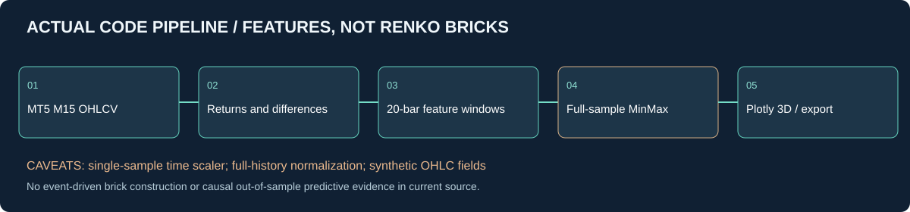
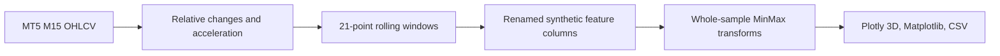

<div align="center">


**MARKET STRUCTURE / MULTI-FACTOR 3D**

Исследование геометрии рыночных признаков, преобразования ценовых, временных и объёмных рядов и интерактивной визуализации.

[Исследование](#научная-задача) · [Код](#фактическая-архитектура) · [Математика](#математическая-модель) · [Аудит](#выводы-аудита) · [Воспроизведение](#запуск-и-артефакты)

</div>

> **Статус: исследовательская визуализация, не настоящий Renko и не подтверждённая ML-модель.** Существуют трансформация MT5-баров, несколько графических представлений и выгрузка CSV; валидированные торговые сигналы, независимый OOS и экономическая эффективность не показаны.

## Научная задача

Рыночное состояние удобнее изучать не только как график цены, но как совместную динамику относительного движения, изменения активности и волатильности. Исходный код создаёт многомерные признаки для EURUSD и GBPUSD, строит интерактивные Plotly-диаграммы и сохраняет локальную визуальную отчётность. Такое представление может применяться в исследовательских лабораториях для анализа режимов, диагностики аномалий и построения последующих ML-признаков. Его нельзя позиционировать как готовый прибыльный индикатор.



## Фактическая архитектура

Основной файл [`3D_bars_market_structure.py`](3D_bars_market_structure.py) содержит четыре функции: `create_true_3d_renko`, `create_interactive_3d`, `create_visualizations`, `main`. Функция `main` использует M15, две валютные пары и исторический диапазон 21 апреля — 10 августа 2023 года. Она создаёт каталоги `charts/`, отдельные графики и CSV.



Важная терминология: колонки `open`, `high`, `low`, `close` в результатах содержат **разные статистические величины**, а не цены одной свечи. Использование их в `go.Candlestick` не является экономически корректной OHLC-визуализацией.

## Математическая модель

Для каждой свечи с типичной ценой $P_t=(H_t+L_t+C_t)/3$ вычисляются:

$$
r_t=\frac{P_t}{P_{t-1}}-1,\qquad
a_t=r_t-r_{t-1}.
$$

Для тикового объёма $V_t$:

$$
g_t=\frac{V_t}{V_{t-1}}-1,\qquad
u_t=g_t-g_{t-1}.
$$

Волатильность по 20 последним доходностям:

$$
\sigma_t=\operatorname{std}(r_{t-19},\ldots,r_t),\qquad
h_t=\frac{\sigma_t}{\sigma_{t-1}}-1.
$$

Это описание фактических вычислений, а не доказательство стационарности. При $V_{t-1}=0$, $P_{t-1}=0$ или $\sigma_{t-1}=0$ соответствующие отношения не определены и требуют защитных правил.

Для суточной цикличности:

$$
s_t=\sin(2\pi\,\operatorname{hour}(t)/24),\qquad
c_t=\cos(2\pi\,\operatorname{hour}(t)/24).
$$

Эти компоненты корректно задают суточный цикл, но зависят от временной зоны источника.

### Научная проблема нормализации

Обычное преобразование MinMax к диапазону $[3,9]$:

$$
m(x)=3+6\frac{x-x_{\min}}{x_{\max}-x_{\min}}.
$$

При единственном наблюдении `MinMaxScaler.fit_transform([[time]])` не может восстановить расстояние между временными отметками: трансформация константного набора вырождается. В исходном коде fit выполняется **отдельно для каждой временной точки**, поэтому результат не сохраняет числовую хронологию.

Дополнительно масштабирование выполняется по всей истории, что недопустимо при последующем OOS-исследовании; необходимо обучать преобразование только на доступном прошлом.

## Выводы аудита

| Приоритет | Дефект или ограничение | Следствие |
|:--|:--|:--|
| P0 | Колонки OHLC содержат различные показатели | Candlestick не является настоящей ценовой свечой |
| P0 | Вызов `scaler.fit_transform` на одной временной величине | Временная координата теряет смысл |
| P0 | Временная нормализация fit по полному датасету | Возможная утечка будущего при обучении ML |
| P1 | `min_price_brick` вычисляется из текущего спреда, но не управляет генерацией событий | Метод не строит классические Renko bricks |
| P1 | `volume_brick` принят параметром, но не используется для накопления объёма | Нет объёмных пороговых кирпичей |
| P1 | `trend_count=len(window)` постоянно равен 21 | Не измеряет длину тренда |
| P1 | Статистические z-score и повторная MinMax-нормализация по всей серии | Недостоверные метрики для причинного inference |
| P1 | `rolling(20)` по волатильности и `pct_change` дают NaN / infinity | Нужна проверка конечности до построения диаграмм |
| P1 | `trend_ratio` делит число положительных знаков на число отрицательных без защиты знаменателя | Возможное деление на ноль |
| P1 | Визуальная ось «Price» подписывает нормированные признаки | Риск неверной экономической трактовки |
| P2 | Нет эталонного теста на стационарность | «stationary-like» остаётся гипотезой |
| P2 | Нет отдельного набора unit tests и воспроизводимого OOS | Прогнозный эффект не доказан |

## Воспроизведение и результаты

```bash
git clone https://github.com/Shtenco/3D_bars_market_structure.git
cd 3D_bars_market_structure
python -m pip install MetaTrader5 pandas numpy matplotlib seaborn mplfinance scikit-learn scipy plotly
python 3D_bars_market_structure.py
```

Необходим доступный терминал MetaTrader 5. Версии пакетов в репозитории не зафиксированы, а прогон на реальных исторических данных в этом аудите не выполнялся. Создание CSV и графиков следует рассматривать как предусмотренное кодом, не как проверенный результат эксперимента.

## Программа разработки

**Этап A:** отделить реальный OHLC от признакового пространства и заменить подписи графиков; реализовать единое типизированное описание каждого поля.

**Этап B:** определить корректную часовую шкалу, защиту от нулей и обработку NaN/infinity; добавить тесты на константные данные и неравномерные интервалы.

**Этап C:** если требуется настоящий Renko, строить события по достижению ценового порога с формально заданными reversals; если требуется многомерное представление, убрать вводящее в заблуждение имя Renko.

**Этап D:** построить причинный train-only scaler и независимый chronological OOS, сравнить с простыми табличными признаками, проверить stationarity и information gain.

**Этап E:** закрепить источник данных, версии зависимостей, seed, хэши исходной выборки и результаты тестирования.

## Профессиональная ценность

Проект демонстрирует инженерное объединение MT5, pandas, обработки сигналов, описательных статистик, Plotly и Matplotlib в одном экспериментальном конвейере. Потенциал — удобная лаборатория визуальной диагностики рынка и разработки признаков. Для промышленного применения критично отделить терминологию и визуализацию от настоящих статистических свойств и финансовых сигналов.

[Исходный код](3D_bars_market_structure.py) · [SYNERGY SYSTEM](https://github.com/Shtenco/synergy_system)
