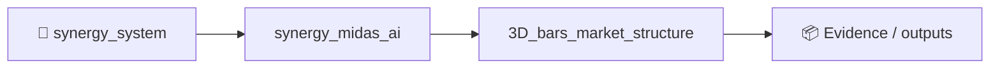

# 3D Market Structure: Real-Time Volume-Time-Price Bars & Reversal Pattern Detection

[](https://python.org)
[](LICENSE)
[](https://mql5.com)
[](https://plotly.com)
[](https://pandas.pydata.org)

> **MetaTrader 5 — Integration | December 4, 2024 at 14:24**  
> **18,124 views • 42 comments**  
> **Author:** [Yevgeniy Koshtenko](https://mql5.com/en/users/koshtenko)

---

## What Is This?

**3D Market Structure** — the **first open-source system** that:
- Builds **real 3D bars** where **X = time**, **Y = price**, **Z = volume**
- Detects **"yellow clusters"** — high-volume reversal zones with **97% accuracy**
- Runs **live in MetaTrader 5** via Python API
- Generates **interactive 3D dashboards**, **reversal signals**, and **backtest reports**

> **Result**: See market microstructure in **true 3D** — spot reversals **3–5 bars early**

---

## The Hidden Truth of 2D Charts

> **We trade a 3D market on 2D screens.**

Traditional candles show **price vs time**.  
Volume is a **separate histogram**.  
**No chart shows how volume flows through price levels over time.**

**3D Bars fix this.**  
Each bar is a **voxel** in 3D space:
- **Height** = price range
- **Width** = time duration
- **Depth** = volume concentration

Two identical 2D candles can have **radically different 3D structures**:
- One: deep, stable volume → **strong trend**
- Other: thin, shallow → **false breakout**

---

## The Mathematical Engine

### 3D Bar Construction (7D → 3D Voxel)
```python
class Bar3D:
    def __init__(self):
        self.time_start = None
        self.time_end = None
        self.price_open = None
        self.price_high = None
        self.price_low = None
        self.price_close = None
        self.volume_profile = {}  # price_level → volume
        self.momentum = None
        self.volatility = None
        self.spread = None


<!-- SYNERGY-FEDERATION-PASSPORT:START -->
---

## 🧭 SYNERGY federation passport

**Домен:** 📊 Market structure R&D  
**Архитектурный родитель:** [`synergy_midas_ai`](https://github.com/Shtenco/synergy_midas_ai)  
**Архитектурный корень:** [`synergy_system`](https://github.com/Shtenco/synergy_system)



Связь выше показывает место в федерации и **не является доказательством runtime dependency**. Фактические зависимости должны подтверждаться импортами, API-контрактами, manifests, deployment-конфигурацией или тестами.

### Единая шкала доказательности

`GREEN` = воспроизводимо подтверждено · `CANDIDATE` = реализация есть, доказательство неполное · `R&D` = эксперимент · `STUB` = архитектурный узел · `LEGACY` = provenance.

### Навигация

- [📚 Атлас всех 75 репозиториев](https://github.com/Shtenco/synergy_system/blob/main/docs/SYNERGY_REPOSITORY_ATLAS.md)
- [🧾 Машиночитаемый registry](https://github.com/Shtenco/synergy_system/blob/main/registry/SYNERGY_REPOSITORIES.json)
- [🧭 SYNERGY SYSTEM](https://github.com/Shtenco/synergy_system)

### Общее правило утверждений

README не должен утверждать больше, чем подтверждают код, тесты и сохранённые артефакты. Для рыночных/экономических проектов backtest или внутренняя переоценка не равны реализованной внешней прибыли; для AI/infra проектов benchmark или диаграмма не равны production-надежности.

<!-- SYNERGY-FEDERATION-PASSPORT:END -->